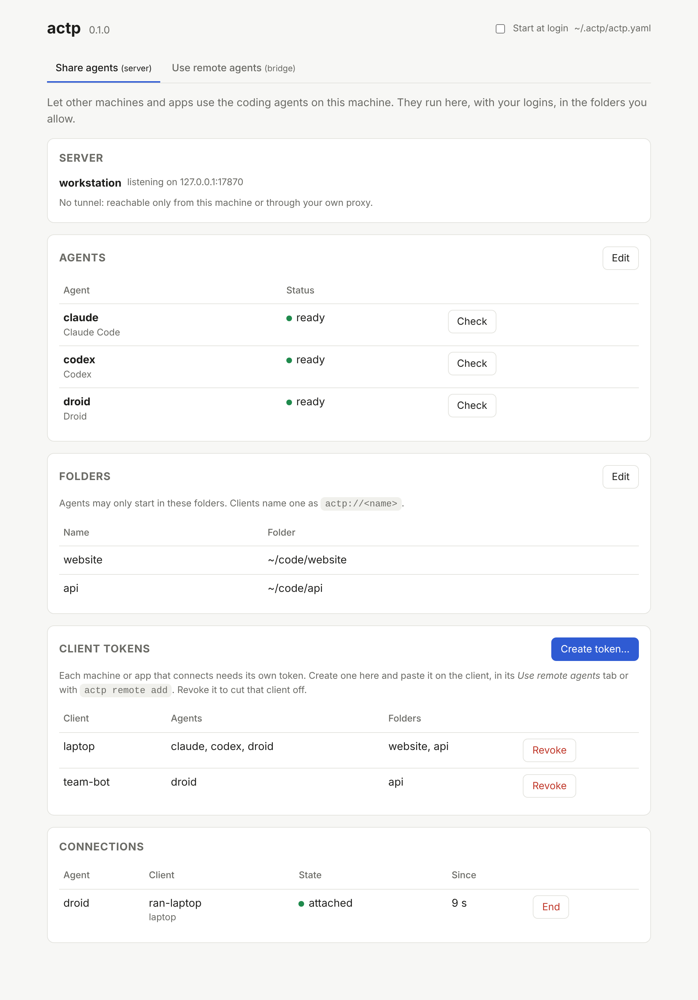

# ACTP – Agent Client Transport Protocol

**ACP over HTTP.** Run coding agents on one machine, use them from anywhere.

ACTP lets any [ACP](https://agentclientprotocol.com) client – an app, a bot, an editor – use a coding agent such as Claude Code, Codex, Droid or Pi that runs on another machine, as if it were local. The agent keeps its own login, files and tools on its machine. The client keeps speaking plain ACP. Neither side needs to change.

```
 ACP client (app, bot, editor)                       machine with the agents
 ─────────────────────────────                       ──────────────────────────────────
 spawns: actp droid@workstation                      actp server
        │  plain ACP over stdio                         │  plain ACP over stdio
        ▼                                               ▼
   actp bridge  ════ HTTPS / WebSocket, token ════►  Droid · Claude Code · Codex · Pi …
```

> **v0.1.0** – the first release. It works end to end, including through a Cloudflare tunnel, and has been tried with real agents. Builds are not signed yet. See [what is done and what is not](docs/design.md#12-implementation-status).

## Why

- **Distributed agents** – keep agents on a strong workstation while your app runs on a small VPS.
- **Personal agents** – connect an assistant running on your Mac to a family or business space.
- **Your own machines** – use the computers you already have, with the logins you already have.
- **Any ACP client** – nothing to add to the client: it starts `actp` instead of a local agent.

## What you get

- **Plain ACP on both ends.** Clients and agents do not know actp is there.
- **Connections that survive drops.** A closed lid or a Wi-Fi change does not stop the agent. The bridge reconnects and catches up without losing or repeating a message.
- **Tokens per client**, limited to the agents and folders you choose, and revocable at any time.
- **Safe defaults.** Agents only start in folders you allow. Files, terminals and local MCP servers stay on the agent's machine.
- **A menu bar app** for macOS (and tray builds for Linux and Windows) with a dashboard, so you do not need to edit config files.
- **Built-in Cloudflare tunnel** for machines without a public address.
- **A Docker image** for servers: deploy it, pick your agents, and connect.
- **Agent installer** in the dashboard (needs Node.js and npm), so adding Claude Code or Codex is one click.



v0.1.0 is built for chat-style clients: apps, bots and assistants that talk to an agent and show what it does. The files live on the agent's machine, so clients that edit files themselves (IDE-style) are not a target yet.

## Install

Download a build from the [releases page](https://github.com/varops/actp/releases):

| File | For |
| --- | --- |
| `actp_<version>_macos.zip` | macOS menu bar app (`actp.app`), Apple Silicon and Intel. |
| `actp-desktop_<version>_<os>_<arch>` | Linux and Windows builds with the tray icon. |
| `actp_<version>_<os>_<arch>` | The command line only, for servers and scripts. |

macOS builds are not signed yet. The first time, right-click `actp.app` and choose **Open**.

Or build from source with Go 1.26+:

```bash
go install github.com/varops/actp/cmd/actp@latest
```

On a Mac, `packaging/macos/build-app.sh` builds `dist/actp.app`.

## Run it in Docker

The image `ghcr.io/varops/actp` has actp, Node.js and `cloudflared`, but no agents. Name the agents you want and pass their API keys:

```bash
docker run -d --name actp -e ACTP_AGENTS=claude-code,codex -e ANTHROPIC_API_KEY=… -e OPENAI_API_KEY=… -v actp-data:/data -v "$PWD/code:/workspaces" -p 127.0.0.1:7861:7861 ghcr.io/varops/actp:latest
```

The log shows the tunnel URL and the dashboard password. The dashboard (port 7861) can install more agents and has a terminal for agent logins. See [`docs/docker.md`](docs/docker.md) for every setting.

## Quick start with the app

On the **machine with the agents**:

1. Open `actp.app`. It lives in the menu bar and opens its dashboard.
2. In **Share agents**, pick the agents you want to share (actp lists the ones installed), the folders they may work in, and whether to use a Cloudflare tunnel. Click **Start sharing**.
3. Under **Client tokens**, click **Create token…** for each machine or app that will connect. Copy the token; it is shown once.
4. Copy the server URL. With a tunnel, wait until it says **reachable** (a new tunnel can take a minute).

On the **client machine**:

1. Open `actp.app` and go to **Use remote agents**.
2. Click **Install the actp command**, then **Add remote…** with a name (for example `workstation`), the URL and the token.
3. Under that remote, copy the command for the agent you want (for example `actp droid@workstation`) and use it as the agent command in your ACP client (see below).

Try it from a terminal:

```bash
actp droid@workstation -p "Say hello and list the files here"
```

## Quick start on the command line

On the machine with the agents, create `~/.actp/actp.yaml`:

```yaml
server:
  listen: 127.0.0.1:7860
  tunnel:
    mode: quick                # or off, behind your own TLS proxy
  workspaces:
    - name: website
      path: ~/code/website
  agents:
    - id: claude
      preset: claude-code      # needs claude-agent-acp on PATH and `claude /login`
    - id: droid
      preset: droid
```

```bash
actp token create --name laptop --default-workspace website
```

```bash
actp doctor
```

```bash
actp serve
```

`actp serve` prints the tunnel URL once it is up. On the client machine:

```bash
echo 'actp_…' | actp remote add workstation https://….trycloudflare.com --token-stdin
```

```bash
actp agents workstation
```

```bash
actp claude@workstation -p "What is in this folder?"
```

## Use it from an ACP client

Use `actp <agent>@<remote>` as the agent command. For example, in Zed's settings:

```json
"agent_servers": {
  "Droid (workstation)": {
    "command": "/opt/homebrew/bin/actp",
    "args": ["droid@workstation"]
  }
}
```

Other clients take the same command and arguments; **Copy as JSON** in the dashboard gives you both. Use the full path to `actp`: apps started from Finder often do not see your shell's PATH.

Useful bridge options:

| Option | What it does |
| --- | --- |
| `--cwd actp://website` | Start every session in the `website` folder on the server, whatever folder the client sends. |
| `--map /local/path=actp://website` | Translate one client folder to a server folder. |
| `--token-env NAME` | Read the token from an environment variable instead of a saved remote. |
| `-p "text"` | Send one prompt and print the answer – for people at a terminal, not for clients. |

The server also accepts a URL directly: `actp droid@https://agents.example.com --token-env ACTP_TOKEN`.

## How it behaves

- **The network drops:** the agent keeps working. The bridge reconnects in the background and receives everything it missed. A permission prompt waits for you.
- **The client quits:** the agent finishes its turn, then the session closes. The client can load the session again later and see what happened. To stop work, the client cancels the turn as usual.
- **The agent asks a question nobody can answer** (the client is gone): it is cancelled at once, so the session does not hang.
- **Folders:** a client folder means nothing on the server. Clients name a server folder as `actp://<name>`, or you map folders in the token or with `--cwd`.

The details are in [`docs/design.md`](docs/design.md), section 3.

## Tunnels

- **`mode: quick`** needs no account. The URL is random and **changes every time the server restarts**. Update your remotes with **Edit** in the dashboard. A new quick tunnel can take a minute to resolve.
- **`mode: named`** with `token_env` gives a stable hostname from your Cloudflare account (a dashboard-managed tunnel token).
- **No tunnel:** put `actp serve` behind your own TLS reverse proxy, or set `tls_cert` and `tls_key`.

If `cloudflared` is missing, the dashboard offers to install it, or run `actp tunnel install`. actp downloads a fixed version and checks a SHA-256 built into actp.

## Troubleshooting

| Symptom | What to check |
| --- | --- |
| "no actp server answers at …" | The URL is wrong or the quick tunnel restarted. Copy the current URL from the server's dashboard. |
| Tunnel "not reachable yet" | Wait a minute. If it lasts, see `~/.actp/logs/cloudflared.log`. |
| "no such host" after a while | Your computer cached "not found": `sudo dscacheutil -flushcache; sudo killall -HUP mDNSResponder` on macOS. |
| An agent shows `auth_required` | Log that agent in on the server machine (for example `claude /login`). |
| Something else | `~/.actp/logs/actp.log` (the app) and `actp doctor`. |

A quick check that a server answers:

```bash
curl https://your-server/health
```

It should print `{"ok":true}`.

## Security

- **A client token is close to a shell.** Whoever holds it can make the agents do anything your user can do on that machine. Folders limit where agents start, not what they can do. Only give tokens to clients you trust, and revoke them when you are done.
- Every request needs a token, including from the same machine: a tunnel makes outside traffic look local.
- Tokens are stored as hashes on the server and in the OS keychain on clients. They never go on a command line.
- On a desktop, the dashboard only listens on `127.0.0.1` and only opens through a one-time link. In Docker it asks for a password instead.
- The dashboard terminal is a shell on the agent machine. It is off on desktops unless you set `dashboard: {terminal: true}` in the config.

## Commands

```
actp serve [--dashboard]                     run the server
actp tray                                    server, dashboard and menu bar icon
actp <agent>@<server> [options]              the bridge an ACP client spawns
actp <agent>@<server> -p "text"              one prompt from a terminal
actp token create|list|revoke                client tokens on a server
actp token generate                          a new token for ACTP_TOKEN (not saved)
actp remote add|list|remove                  saved servers on a client
actp agents <server>                         what a server offers
actp tunnel install                          download cloudflared
actp doctor                                  check the config and the agents
actp container                               run in the Docker image
actp version
```

## Documents

- [`docs/design.md`](docs/design.md) – public API, configuration, behaviour, and what is done.
- [`docs/agents.md`](docs/agents.md) – supported agents, how to start them, and their quirks.
- [`docs/docker.md`](docs/docker.md) – the Docker image and its settings.
- [`api/openapi.yaml`](api/openapi.yaml) – the HTTP API.
- [`docs/native-clients.md`](docs/native-clients.md) – how to make an ACP client talk to actp directly, without the bridge.
- [`docs/wire.md`](docs/wire.md) – the `actp.v1` wire format between bridges (or native clients) and servers.
- [`docs/brainstorm.md`](docs/brainstorm.md) – early notes and decisions.

## Development

```bash
go test -race ./...
```

```bash
go generate ./api/
```

The second command regenerates the HTTP code after a change to `api/openapi.yaml`. CI runs the tests on Linux, macOS and Windows and builds `actp.app` on a Mac. Pushing a `v*` tag builds every platform into a draft GitHub release.

## Contributing

Bug reports, fixes and new agent presets are welcome: see [CONTRIBUTING.md](CONTRIBUTING.md). Please report security problems privately, as described in [SECURITY.md](.github/SECURITY.md).

## License

[Apache 2.0](LICENSE).
